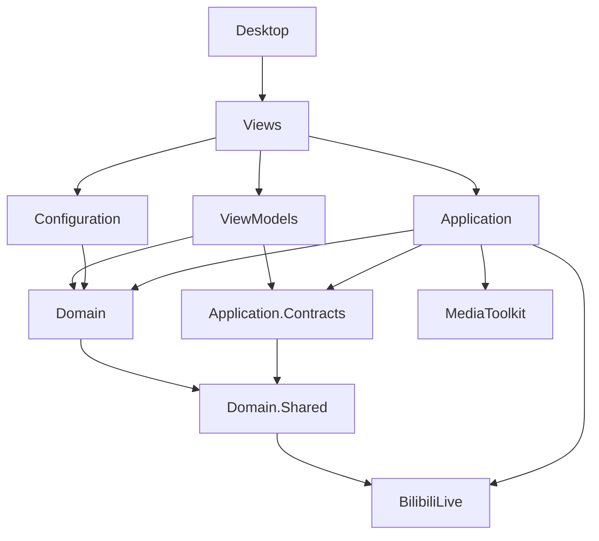

# BilibiliLiveRecordDownLoader

跨平台的 Bilibili 直播录制工具，支持 Windows、Linux 和 macOS。

## 主要功能

- [x] 同时监控和录制多个直播间
- [x] 通过弹幕连接实时感知开播、下播和标题变化，并定时轮询兜底
- [x] 录制 HTTP-FLV、HLS-TS、HLS-fMP4 流，可按编码和格式优先级选择
- [x] 内置录制或 FFmpeg 录制
- [x] 开播提醒
- [x] 扫码登录，登录后可录制付费直播
- [x] 录制完成后自动转 MP4
- [x] 转封装、修复 FLV、剪辑片段
- [x] 托盘常驻、开机自启

FFmpeg 不随程序分发。转 MP4、剪辑和 FFmpeg 录制需要先安装 FFmpeg，可在设置中指定路径，留空时从 `PATH` 查找。

## 下载

[正式版](https://github.com/HMBSbige/BilibiliLiveRecordDownLoader/releases)

[测试版](https://github.com/HMBSbige/BilibiliLiveRecordDownLoader/actions/workflows/CI.yml)

## 架构

- `BilibiliLive`：直播间 API、扫码登录、弹幕和直播流读取
- `MediaToolkit`：FFmpeg 调用和 FLV 音视频分离
